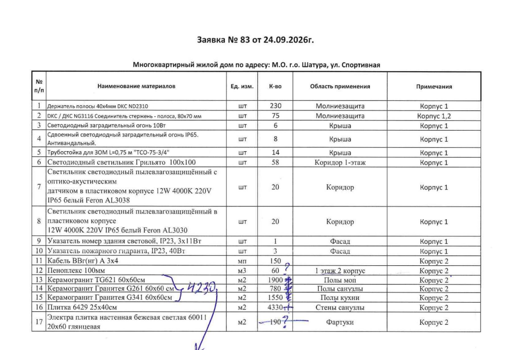
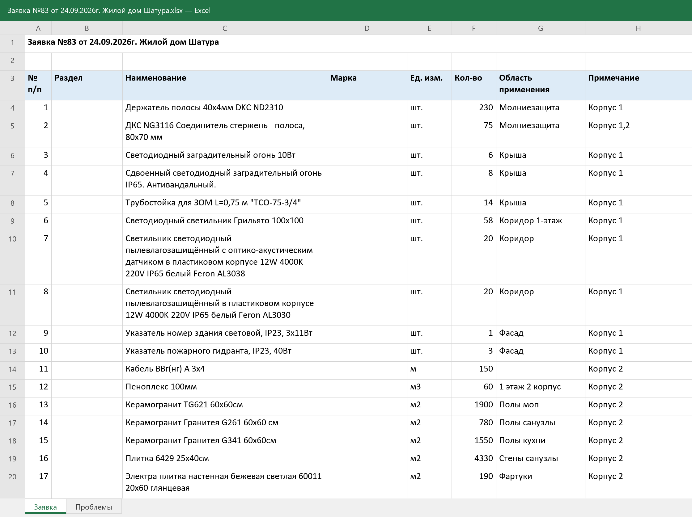
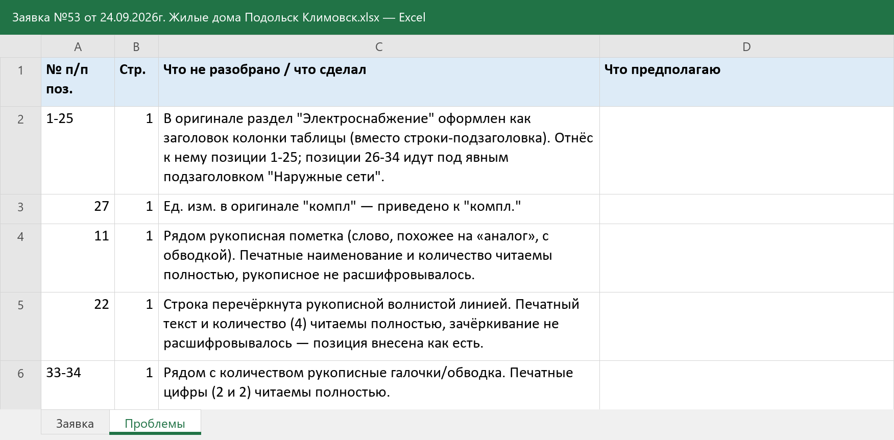
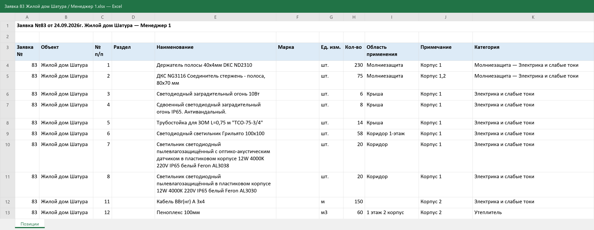

# Заявки с объектов: из PDF в Excel и по менеджерам снабжения

Конвейер на Claude Code для отдела снабжения строительной группы компаний. Отсканированные заявки на закупку превращаются в таблицы Excel, а каждая позиция автоматически уходит ответственному менеджеру.

## Для кого

**Пользователь** — директор ТД «Дикес», компании, которая работает отделом снабжения в ГК «Триумф». Группа строит школы, детские сады, поликлиники, больницы и жилые дома. Отдел закупает для объектов стройматериалы, инструмент и оборудование.

В отделе пять менеджеров, у каждого свои категории материалов: электрика, крепёж, плитка, металлопрокат, сухие смеси и т.д. С кодом пользователь не работает: ему нужны готовые файлы Excel и короткий отчёт с цифрами.

## Какую задачу решает

Каждый день объекты присылают заявки на материалы. Это сканы бумажных документов: печатная таблица, подписи, рукописные пометки и галочки. Вручную всё шло так:

1. Перепечатать заявку в Excel.
2. Разобрать позиции и решить, какой менеджер за какую отвечает.
3. Раздать каждому менеджеру его часть.

На заявку в 30–40 позиций уходило много времени, и позиции терялись или попадали не тому менеджеру.

Теперь всё делается одной командой — `/zayavki`:

1. **Находит новые заявки.** Берёт PDF из `data/`, которых ещё нет в журнале обработки.
2. **Распознаёт скан.** Страница отрисовывается в картинку и читается построчно. Переносится только печатный текст, рукописные пометки не учитываются. Единицы измерения приводятся к одному виду, количество записывается числом.
3. **Собирает Excel по заявке.** Лист «Заявка» — чистая таблица позиций, лист «Проблемы» — всё, что не прочиталось или было исправлено. Оговорки не смешиваются с данными.
4. **Раскладывает по менеджерам.** Каждая позиция уходит ответственному строго по таблице распределения. Спорные и нераспознанные позиции не выбрасываются: их получает самый вероятный менеджер с пометкой «спорно».
5. **Сверяет.** Сумма позиций у всех менеджеров должна совпасть с числом позиций в заявке.
6. **Отчитывается.** Выдаёт одну сводку по всем заявкам и отдельный список спорных мест.

## Как устроено

| Компонент | Где лежит | Что делает |
|---|---|---|
| Скилл `zayavki` | `.claude/skills/zayavki/SKILL.md` | Проводит весь цикл: ищет новые PDF, запускает агентов по очереди, ведёт журнал, готовит общий отчёт |
| Агент `zayavki-pdf-to-excel` | `.claude/agents/zayavki-pdf-to-excel.md` | Переводит PDF в Excel: один xlsx на каждую заявку |
| Агент `zayavki-po-menedzheram` | `.claude/agents/zayavki-po-menedzheram.md` | Раскладывает позиции готовой заявки: отдельный xlsx на каждого менеджера |
| Правила проекта | `CLAUDE.md` | Структура папок, ограничения и формат отчёта |

## Структура папок

```
.claude/     агенты и скилл
data/        входящие PDF-заявки (только чтение)
docs/        таблица распределения материалов между менеджерами
reports/
  Заявки готовые/         заявки в Excel + Журнал обработки.csv
  Заявки по менеджерам/   подпапка на заявку, внутри файл на каждого менеджера
scripts/     служебные скрипты (рендер PDF, сборка xlsx)
screenshots/ скриншоты результатов для README
tmp/         промежуточные файлы
```

## Правила

- Исходные PDF и таблица распределения только читаются: их не меняют, не переименовывают и не удаляют.
- В таблицы попадает только то, что есть в заявке. Пустая ячейка означает «в документе не указано».
- Каждая позиция лежит ровно в одном файле менеджера.
- По журналу видно, какой PDF в какой Excel превратился и когда. Повторно обработать заявку можно, назвав её явно.

## Что получается на выходе

В репозитории лежит прогон на трёх реальных заявках: 74 позиции разложены четырём менеджерам, число разложенных позиций совпадает с числом позиций в каждой заявке. Ниже каждый шаг показан на заявке №83.

### 1. На входе — скан заявки с объекта

Печатная таблица, рукописные пометки, подписи. Текстового слоя нет, это просто картинка.



### 2. Заявка в Excel — лист «Заявка»

Та же заявка в виде чистой таблицы:
- в шапке номер, дата и объект;
- единицы измерения приведены к одному виду («мп» → «м»);
- количество записано числом, по нему можно считать;
- рукописные «?», «4230» и «осталось 3200 м²» в таблицу не попали.



### 3. Лист «Проблемы» — всё, что требует внимания

Сюда агент записывает свои правки и сомнения, чтобы не смешивать их с данными. Пример из служебной записки №53: строка, перечёркнутая от руки, и раздел, который пришлось определить самому.



### 4. Файл менеджера

По каждой заявке создаётся папка, в ней отдельный файл на каждого менеджера. В колонке «Категория» указано, по какой строке таблицы распределения позиция досталась именно ему. Спорные позиции помечаются там же: «спорно: возможно Менеджер N».



### 5. Итоговый отчёт в чате

```
Все 3 новые заявки переведены в Excel и разложены по менеджерам: 74 позиции ушли 4 менеджерам.

| Заявка                     | Позиций | Менеджеры (позиций)         | Сверка |
|----------------------------|---------|-----------------------------|--------|
| №83 Жилой дом Шатура       | 17      | М1 10, М3 5, М4 1, М2 1     | ок     |
| №53 Жилые дома Климовск    | 34      | М2 21, М1 9, М4 4           | ок     |
| №44 ДОУ Видное             | 23      | М1 9, М2 8, М4 3, М3 3      | ок     |

Что проверить:
- СЗ 53, поз. 22 «Масляный обогреватель» — строка зачёркнута от руки, внесена как есть.
- №44, поз. 8 «Газобетонная перемычка» — ЖБИ (Менеджер 1) или стеновые материалы (Менеджер 3).
- ...
```

### Структура результата

```
reports/
├── Заявки готовые/
│   ├── Журнал обработки.csv
│   ├── Заявка №44 от 23.09.2026г. ДОУ Видное.xlsx
│   ├── Заявка №53 от 24.09.2026г. Жилые дома Подольск Климовск.xlsx
│   └── Заявка №83 от 24.09.2026г. Жилой дом Шатура.xlsx
└── Заявки по менеджерам/
    ├── Заявка 44 ДОУ Видное/            Менеджер 1–4.xlsx
    ├── Заявка 53 Жилые дома Подольск Климовск/   Менеджер 1, 2, 4.xlsx
    └── Заявка 83 Жилой дом Шатура/      Менеджер 1–4.xlsx
```

В публичной версии убраны личные данные: вместо ФИО менеджеров стоят «Менеджер 1–5», телефонов нет, а подписи и ФИО подписантов в PDF закрыты.

## Запуск

Нужны [Claude Code](https://claude.com/claude-code), Python 3 и библиотеки `openpyxl`, `pypdfium2`, `Pillow`, `pdfplumber`.

1. Положить PDF-заявки в `data/`.
2. Открыть папку в Claude Code и выполнить `/zayavki`.
3. Забрать результат из `reports/`.
